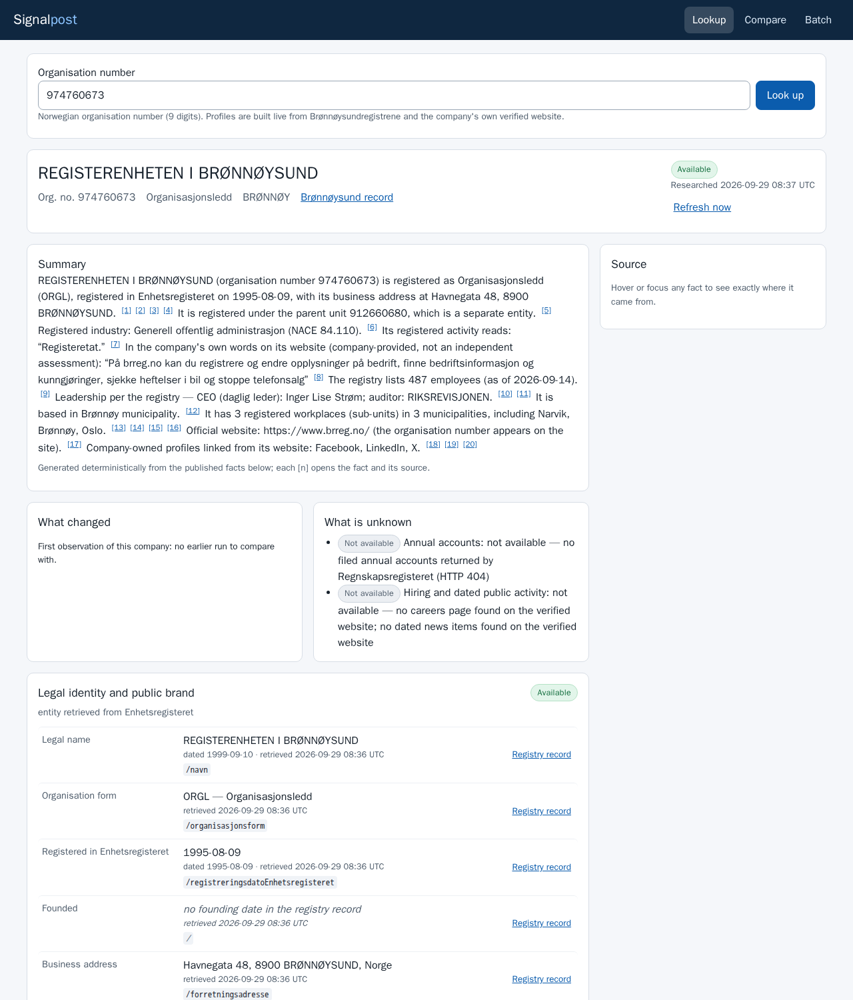

# Signalpost — Registry-First Evidence Agent

A command-line agent and small web UI that turns a Norwegian organisation number into a company
profile where **every fact links to the exact record it came from, with its date**. Built for the
[Builderr Signalpost](https://builderr.ai/challenges/signalpost) challenge.

- **Registry first.** Identity, status, industry, employees, roles, registered workplaces, latest
  filed accounts and filing history come from Brønnøysundregistrene's open APIs, each fact citing
  the exact API URL, an RFC 6901 JSON pointer, the registry's own date and our retrieval time.
- **Then the company's own website**, only after exact-entity proof (organisation number on the
  site, or legal name + registered address/phone). Parent, group and brand sites are labelled
  `ambiguous`, never merged. Description, social-profile links, careers page, job postings and
  dated news come with page URL, CSS selector, text span, date and content hash.
- **Honest states.** One terminal envelope per input with `available`, `not_available`, `blocked`,
  `not_applicable`, `ambiguous` or `failed` — per envelope, section and claim. Absence is never zero.
- **Refresh as a diff.** Immutable snapshots, a claim store with stable keys, typed changes
  (`new_role`, `changed_address`, `new_filing`, …) with both sides' evidence; re-running the same
  snapshot changes nothing.
- **Deterministic summary** whose every sentence cites the claims and evidence it rests on.



## Quick start

```bash
python3 -m venv .venv && .venv/bin/pip install -r requirements.txt           # install (Python ≥ 3.11)
.venv/bin/python -m signalpost run --input smoke/input.jsonl --output out/envelopes.jsonl --report out/report.json
.venv/bin/python -m signalpost serve --host 0.0.0.0 --port 8000              # UI on http://localhost:8000/
```

Then open `http://localhost:8000/company/923609016` (Equinor) for a live profile, or
`http://localhost:8000/batch` to browse the 100 companies the run above just produced.

Full instructions (all options, resume, time budget, UI URLs, tests, replay, self-score, Docker):
**[RUN.md](RUN.md)**.

## 100-company smoke test

[`smoke/`](smoke/README.md): 100 random universe companies (seed 20260929) → 100 envelopes, all
`available`, 47 s total (p50 2.6 s, p95 6.3 s per company), 514 requests, $0; a second run on the
same state reports 0 changes. Company websites were unreachable from the development sandbox, so
the website/hiring sections in that file are mostly `failed`/`not_available`.

## Independent verification

A separate verifier re-ran the checks below from a fresh clone (empty virtualenv, only the
declared install step, then the run command in [Quick start](#quick-start)):

- **Clean-clone 100-company run** (seed 73101): exit 0, 100/100 envelopes, 38.3 s, p50 2,086 ms,
  p95 6,168 ms, 518 requests, peak memory 54 MB, $0.
- **1,100-company batch** (seed 737373): exit 0, 1,100/1,100 envelopes, 298 s wall, p50 1,451 ms,
  p95 6,013 ms, 4,553 requests, peak memory 181 MB, $0 — about 5–7 minutes per 1,000–1,100
  companies at 8 workers.
- **Accuracy oracle**: 100 companies checked directly against live Brønnøysund data — **0
  mismatches** across legal name, form, address, NACE code, employees, CEO, chair, revenue,
  operating result, net result, equity, total assets, currency, period and subunit count. 0
  wrong-company facts, 0 fabricated financial values.
- **Evidence spot-check**: a live sample of 250 claim/evidence pairs was 250/250 valid (source URL
  returns 200, content sha256 matches, its RFC 6901 pointer resolves to the claimed value).
- **Tests and robustness**: 68 offline pytest tests pass; the Docker image builds and runs,
  including with `--network none` (dependencies are baked in); 10/10 trials of concurrent runs
  against one state directory finished clean, no lost or duplicated companies.

## Self-score (honest, against the public rubric)

From `smoke/selfscore.md`, widened with the verifier's independent estimate (our estimate —
Builderr's pooled reference set is hidden):

| Dimension | Estimate | Basis |
|---|---:|---|
| Recall & coverage (50) | 15–30 | registry families (identity, accounts, roles, workplaces) at 100 % of companies. Website/description/social/jobs/news recall on the open internet is the swing factor: the development sandbox cannot reach company websites, so it was tested only with saved fixtures and live on www.brreg.no — not measurable here. |
| Precision & evidence (30) | 27–30 | a live, independent sample of 250 claim/evidence pairs was 250/250 valid (source URL returns 200, content sha256 matches, the RFC 6901 pointer resolves to the claimed value); org number is the identity key; websites need exact-entity proof |
| Synthesis (12) | 9–10 | every summary sentence cites claims; changes and unknowns always stated |
| UX (8) | 7–8 | profile, compare and batch browser checked at 1280 px and 375 px across every state (empty, errors, loading, available, not found, deleted, bankrupt, blocked, failed, ambiguous, partial, compare, batch, what-changed, hover-to-source); source inspector on hover/focus |
| **Total** | **≈ 58–78**, straddling the 65 qualification line | the range is driven almost entirely by external (website/jobs/news) recall on the open internet |

## Declaration

| Item | Value |
|---|---|
| Models / LLMs | none |
| APIs | Brønnøysundregistrene Enhetsregisteret and Regnskapsregisteret open APIs (no key); companies' own public websites |
| Paid / third-party services | none |
| Expected cost per official run | **$0** (1,000–1,100 companies) |
| Secrets / env vars | none required; `SIGNALPOST_ALLOW_PRIVATE_HOSTS` is a test-only switch |
| Licences | this code: MIT (`LICENSE`); dependencies: httpx (BSD-3), httpcore (BSD-3), h11 (MIT), anyio (MIT), idna (BSD-3), certifi (MPL-2.0), typing_extensions (PSF), beautifulsoup4 (MIT), soupsieve (MIT); data: Brreg open data under NLOD 2.0 |
| External caches | none; the optional `--registry-snapshot` file is supplied by the evaluator |

## Documentation

- [RUN.md](RUN.md) — install, run, UI, tests, resume, refresh, Docker
- [docs/DATA_SCHEMA.md](docs/DATA_SCHEMA.md) — envelope, sections, claims, evidence
- [docs/SOURCES_AND_POLICY.md](docs/SOURCES_AND_POLICY.md) — source rights, robots, rate limits, URL safety, secrets, privacy
- [docs/IDENTITY_AND_ABSTENTION.md](docs/IDENTITY_AND_ABSTENTION.md) — candidate and publication gates
- [docs/REFRESH.md](docs/REFRESH.md) — snapshots, claim store, change types
- [docs/LIMITATIONS.md](docs/LIMITATIONS.md) — known gaps

## Live link

No public instance: hosting needs an account we do not have (see LIMITATIONS). The UI runs locally
or with `docker run -p 8000:8000 signalpost`.

## Submission status / blockers

- **Repository is not yet public.** Publishing it needs a human GitHub account: create a public
  repo and push this history to it.
- **No live link.** Hosting a public instance needs a hosting account (Live link, above). Until
  then, judges run it locally or in Docker in under 5 minutes (Quick start, above).

## Licence

MIT — see [LICENSE](LICENSE).
